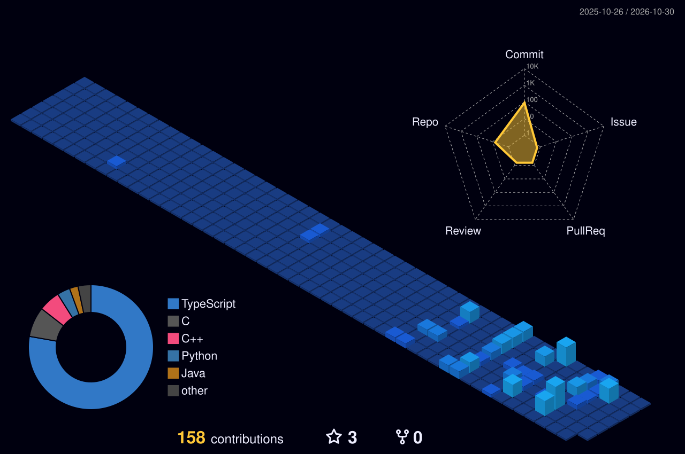

<div align="center">

  <!-- Dynamic Waving Obsidian Header -->
  

  <!-- Animated Typing Terminal SVG -->
  <a href="https://github.com/abidghumay">
    
  </a>

  <br/>

  <!-- High-Contrast Status Badges -->
  <a href="https://cse.buet.ac.bd/">
    
  </a>
  
  

</div>

---

## 💻 About Me

```c
/* Systems Engineering & Architecture */
typedef struct {
    const char *institution;  /* BUET (Bangladesh University of Engineering and Technology) */
    const char *discipline;   /* Computer Science & Engineering                           */
    const char *focus[];      /* {"Systems Internals", "Memory Layouts", "Concurrency"}     */
    const char *toolset[];    /* {"GDB Disassembly", "Linux CLI", "PostgreSQL Internals"}   */
} SystemsEngineer;
```

* 🎓 **Undergraduate Student in Computer Science & Engineering at [BUET](https://cse.buet.ac.bd/)**
* ⚙️ Exploring **Systems Internals, Virtual Memory, POSIX system calls, and performance optimization**
* 🔍 Inspecting memory dumps, register states, and runtime execution with **GDB**
* ⚔️ Active competitive programmer on Codeforces: [**`NIFAO`**](https://codeforces.com/profile/NIFAO)
* 🧱 Architecting typed services and query engines with **C/C++, PostgreSQL, and TypeScript**

---

## 🧰 Tech Stack

<div align="center">

### ⚡ Core Systems & Low-Level
<p align="center">
  
  
</p>

### 🗄️ Backend, Data & Typing
<p align="center">
  
</p>

### 🛠️ Workflow & Development
<p align="center">
  
</p>

</div>

---

## 🌐 3D Isometric Contribution Landscape

<div align="center">



<sub><i>Rendered daily in full 3D isometric projection via automated GitHub Actions.</i></sub>

</div>

---

## 🧩 Competitive Programming

<div align="center">

### Codeforces

<a href="https://codeforces.com/profile/NIFAO">
  
</a>

</div>

---

## ⚡ GitHub Metrics

<div align="center">

<a href="https://git.io/streak-stats">
  
</a>

<br/><br/>


</div>

---

## 🐍 Commit Matrix Arcade

<div align="center">


</div>

---

<div align="center">

```c
/* "Optimization is not about speed; it's about eliminating waste." */
int main(void) {
    return 0;
}
```

</div>
